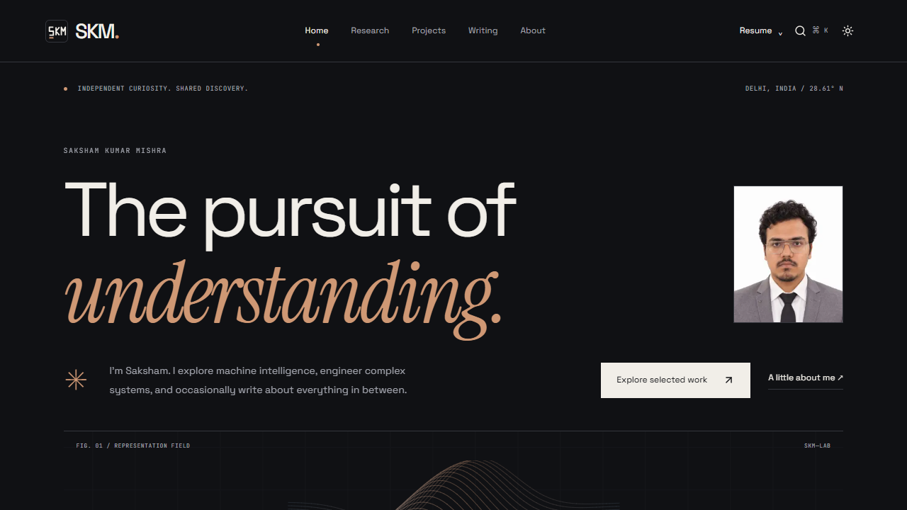
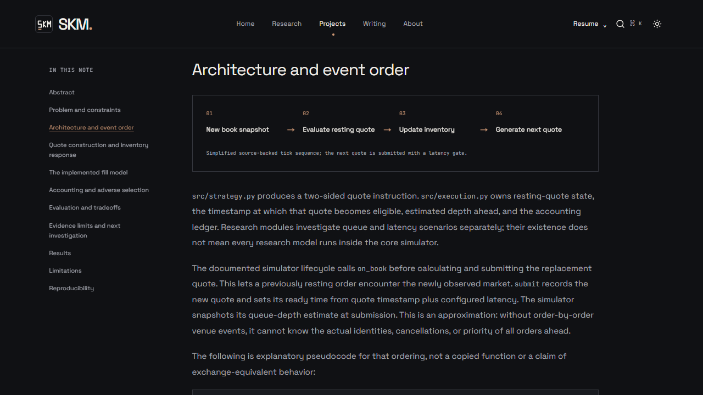
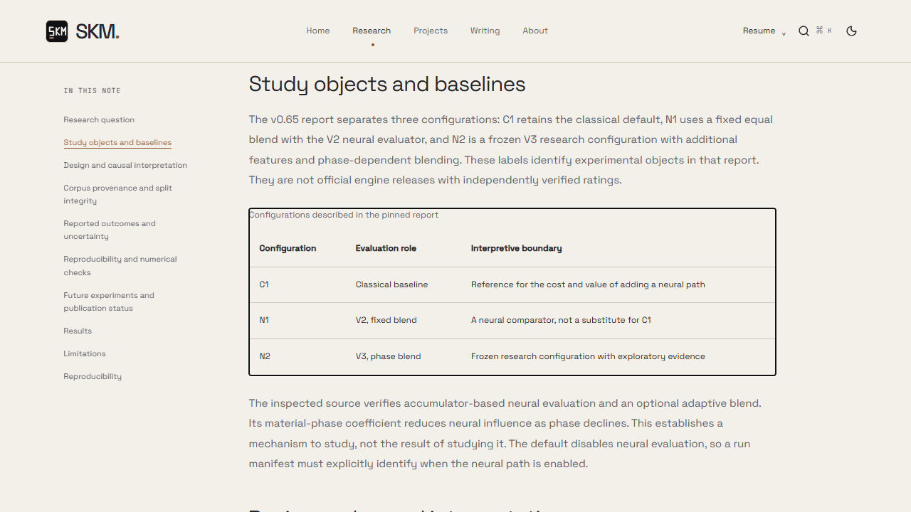
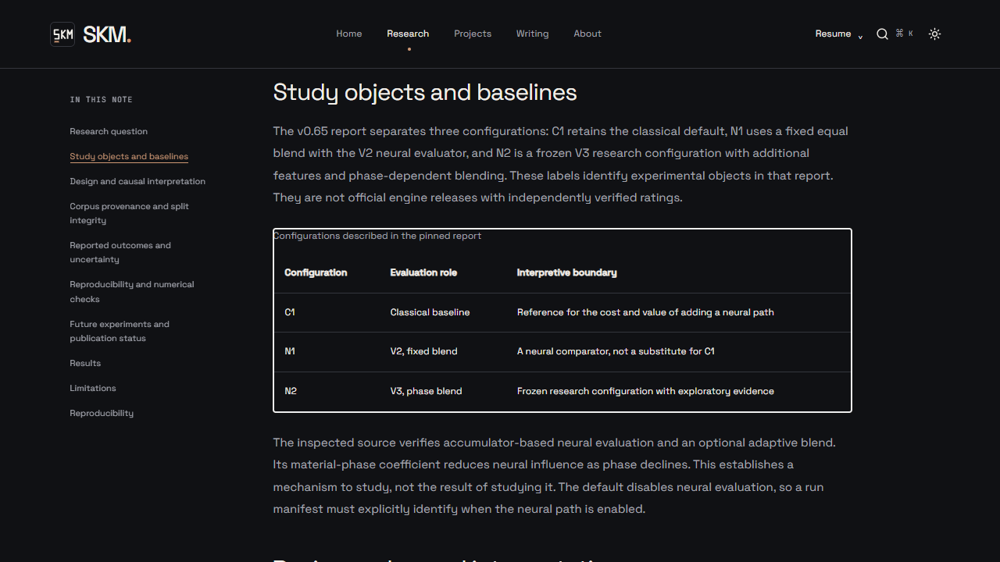
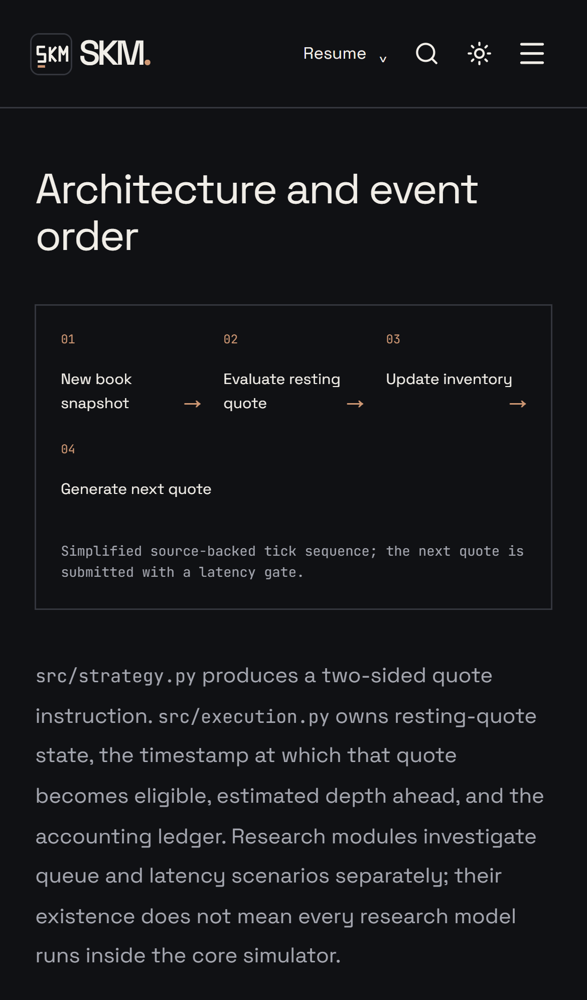
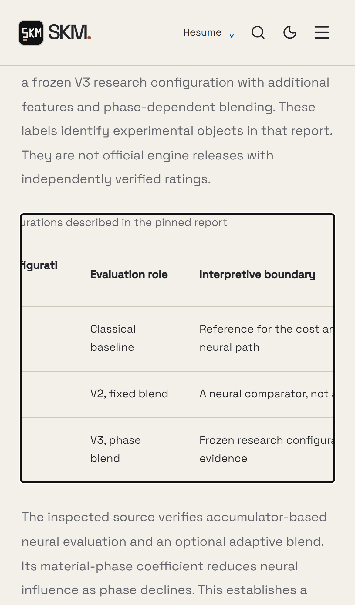
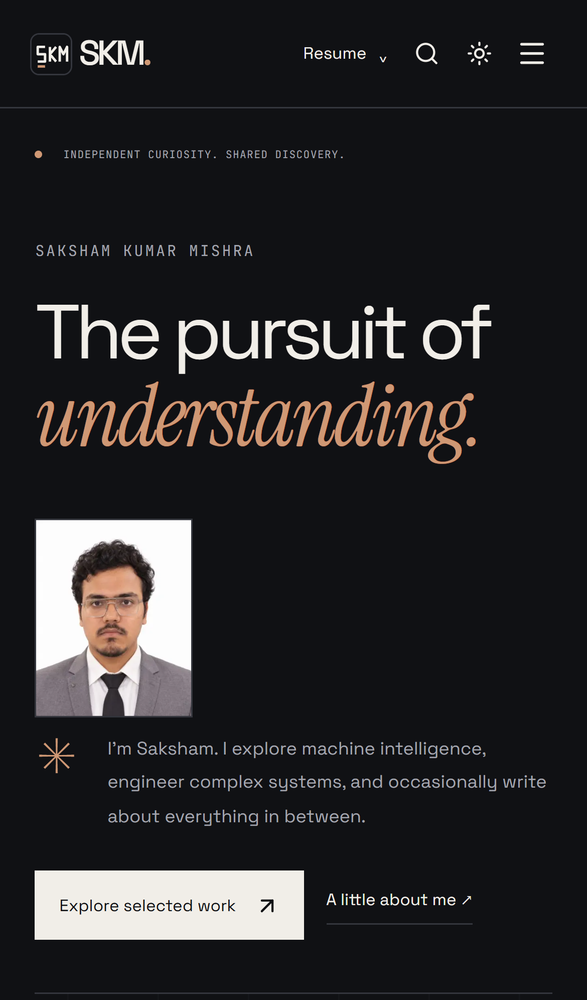

# M3.1 Visual review

Date: 2026-11-10. Screenshots come from the production build through the repository's Playwright desktop Chrome and mobile Chromium profiles. They are actual page captures, not mockups. The automated final run and manual screenshot inspection are recorded separately below.

## Desktop observations

The homepage retains the typography-first composition, compact authentic grey-suit portrait, restrained accent color, five navigation tabs, and résumé disclosure. The editorial expansion changes the destination articles, not the hero's hierarchy.

The FlowState article retains the 740-pixel maximum reading column. Its sticky contents show the active section through both accent color and an underline. Anchor destinations clear the fixed header after correcting the combined scroll-padding/margin offset. Diagram labels and their source-scope caption remain legible without heavy effects.

The research evidence table is readable in both themes. Its visible outline in these captures is intentional keyboard focus, not a permanent decorative border. The table describes configurations and evidence boundaries; it does not present invented benchmark data. Body text and the caption use the existing design tokens.

Directory captures are retained for comparison: [Projects desktop](assets/m3.1/projects-desktop.png), [Research desktop](assets/m3.1/research-desktop.png). The catalogue, category/status filters and research statuses are preserved.

## Mobile review

The mobile captures use a 390 × 664 CSS-pixel viewport at device scale 3; desktop captures use 1280 × 720. The mobile FlowState diagram wraps its fourth numbered stage onto the next row without widening the page. Its caption and prose remain within the reading column. Section targets clear the fixed mobile header.

The wide research table scrolls inside its focused region. The capture below deliberately follows a keyboard ArrowRight action, so the left edge of the table is partly outside the scroll viewport; the page itself does not overflow. The mobile tests confirm that the region receives focus and its horizontal scroll position changes. Code and display equations similarly retain keyboard access when wider than the reading column.

The authentic homepage portrait remains subordinate to the headline and uses its existing mobile placement. The compact navigation retains its menu, résumé, search and theme controls.

Additional captures: [mobile dark table](assets/m3.1/chess-mobile-dark.png), [mobile Projects](assets/m3.1/projects-mobile.png), and [mobile Research](assets/m3.1/research-mobile.png). Mobile contents remain in flow above the article rather than consuming a sticky side column.

## Verification scope

The new desktop and mobile checks passed on the corrected build: reading width, both themes, active keyboard anchor navigation, math/code/diagram rendering, focusable table scrolling, axe scans, and bounded layout stability. The test checks document overflow and observes cumulative unexpected layout shifts below 0.1 during its local window, plus less than one pixel of settled article dimension change. This is not a field-performance or physical-device certification.

Reduced-motion handling remains in place; section navigation uses native anchors and no scroll hijacking. Code and display equations retain horizontal scrolling where needed, with labeled focusable regions added after mobile accessibility findings. Literal MDX tables use `TableScroll`; JavaScript attribute expressions remain blocked.

The final browser totals and limitations are in [Verification](M3.1-VERIFICATION.md). No images, résumé PDFs, affiliation text, contact infrastructure, or navigation design were replaced for this milestone.
